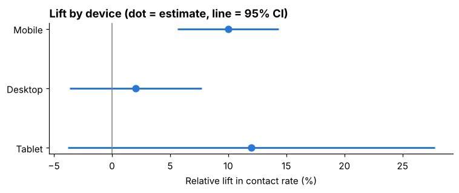

# A/B Test: Listing-Page "Contact Agent" Button

**Did moving the "Contact agent" button higher on a home-listing page get more buyers to contact an agent?**

Tools: **SQL** (SQLite) · **Python** (pandas, SciPy, matplotlib) · **Excel**

> Data is **simulated** (120,000 users), because companies don't publish real A/B test data.
> See `generate_data.py`.

## Results

| | Control | Treatment |
|---|---|---|
| Users | 59,996 | 60,004 |
| Contact rate | 10.33% | 11.09% |

- **Overall lift: +7.3%** (95% CI +3.9% to +10.7%), p < 0.0001: statistically significant
- **Mobile: +10.0%** (significant). **Desktop: +2.0%** (not significant). **Tablet:** too few users to tell
- **Guardrail:** page load +32 ms, within the 100 ms limit
- **Split check:** 50/50 split confirmed (p = 0.98)



## Files

| File | What it does |
|---|---|
| `analysis.ipynb` | **Start here.** Step-by-step analysis: SQL queries, statistical tests, chart, recommendation |
| `ab_test_results.xlsx` | The same test in Excel with live formulas, plus a sample-size calculator |
| `generate_data.py` | Creates the simulated dataset |
| `make_excel.py` | Builds the Excel file (SQL pulls the counts; Excel formulas do the math) |

## Steps in the analysis

1. **Split check:** chi-square test that users were divided 50/50 (catches broken experiments)
2. **Contact rates:** SQL `GROUP BY` on the experiment table
3. **Significance:** two-proportion z-test, p-value and 95% confidence interval
4. **Segments:** same test by device, with a Bonferroni correction for testing 3 groups
5. **Guardrail:** t-test on page load time
6. **Recommendation** and limitations

## Run it

```bash
pip install -r requirements.txt
python generate_data.py
jupyter notebook analysis.ipynb
python make_excel.py
```
